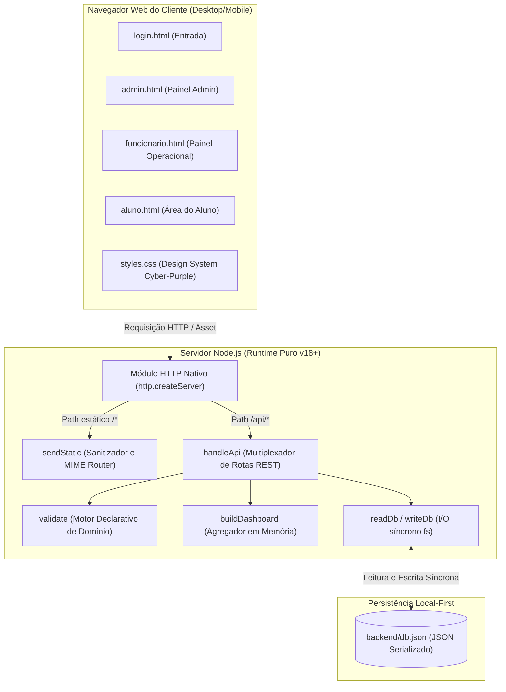
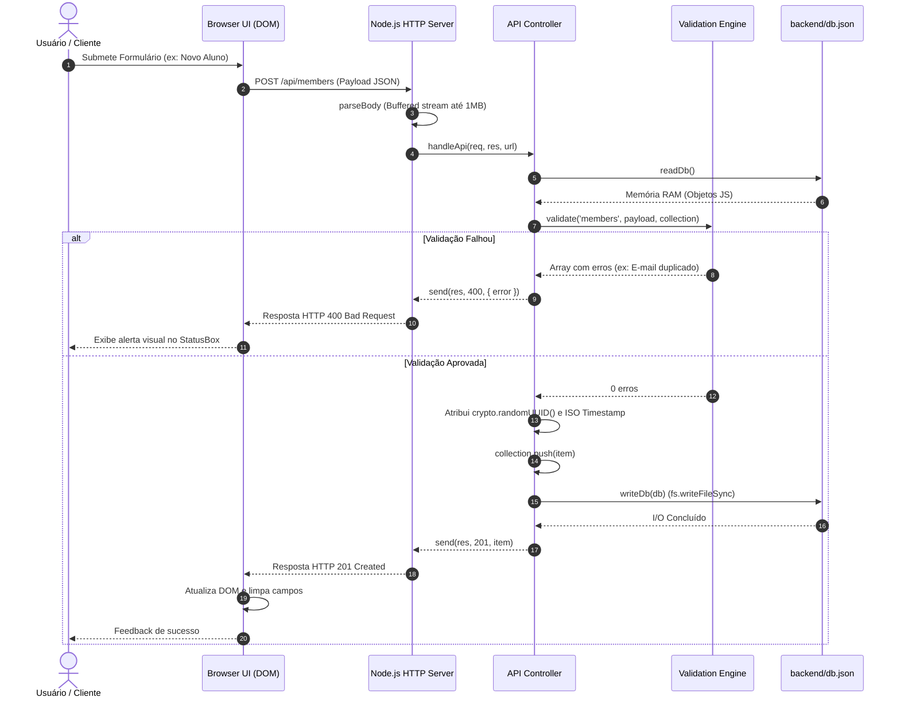

# 🎓 ARTIGO TÉCNICO-CIENTÍFICO DE ENGENHARIA DE SOFTWARE
## Padrão SBC / IEEE Computer Society

---

### **Arquitetura Zero-Dependency em Aplicações Web Corporativas: Um Estudo de Caso sobre Desacoplamento, Acessibilidade e Limites Transacionais no Sistema FitGesty**

**Autor:** Kazuhiro Kamimura  
**Afiliação:** Curso de Tecnologia em Análise e Desenvolvimento de Sistemas (TADS) — Universidade Católica Dom Bosco (UCDB)  
**Contato:** `kazuhirokamim` (GitHub)  
**Área do Conhecimento:** Engenharia de Software, Sistemas Distribuídos e Interação Humano-Computador  

---

### **RESUMO**

O ecossistema contemporâneo de desenvolvimento web em JavaScript caracteriza-se por uma profunda dependência de *frameworks* de alto nível e árvores massivas de módulos de terceiros (*node_modules*), frequentemente introduzindo vulnerabilidades de cadeia de suprimentos (*supply chain attacks*), consumo inflacionado de memória e sobrecarga cognitiva. Este artigo investiga a viabilidade, eficácia e os *trade-offs* de projetar uma aplicação corporativa completa utilizando estritamente a biblioteca padrão do Node.js e tecnologias fundamentais da web (HTML5, CSS3 e Vanilla JavaScript). O objeto empírico de análise é o sistema **FitGesty**, uma plataforma de gerenciamento operacional para centros esportivos e academias com controle de matrículas, delegação de tarefas, gestão de recursos físicos e comunicação interna. Apresentam-se os padrões arquiteturais aplicados, a implementação de diretrizes de acessibilidade digital (WCAG 2.1 AA), a modelagem de um motor declarativo de validação de domínio em memória e a avaliação formal da complexidade assintótica $O(n)$ do subsistema de persistência em arquivo plano serializado em JSON. Discutem-se as fronteiras de escalabilidade e as limitações inerentes de concorrência e atomicidade $ACID$ sob a ausência de um SGBD transacional.

**Palavras-chave:** Zero-Dependency Architecture; Node.js Nativo; Vanilla JavaScript; Acessibilidade na Web (WCAG); Concorrência e ACID; Engenharia de Software.

---

### **ABSTRACT**

The modern JavaScript web development ecosystem is heavily reliant on high-level frameworks and massive third-party dependency trees (*node_modules*), frequently introducing supply-chain security vulnerabilities, bloated memory consumption, and accidental complexity. This paper examines the feasibility, performance, and engineering trade-offs of designing a full-stack corporate web application solely utilizing the Node.js standard library and core web primitives (HTML5, CSS3, and Vanilla JavaScript). The empirical artifact evaluated is **FitGesty**, an enterprise operational management platform for fitness centers encompassing membership tracking, task scheduling, physical resource governance, and corporate communications. We detail the underlying architectural patterns, accessibility implementations adhering to WCAG 2.1 AA standards, an in-memory declarative domain validation engine, and an asymptotic time-complexity analysis of its flat-file JSON persistence layer. Finally, we explore the scalability boundaries, concurrency hazards, and $ACID$ transaction limitations in the absence of a transactional database management system.

**Keywords:** Zero-Dependency Architecture; Native Node.js; Vanilla JavaScript; Web Accessibility (WCAG); Concurrency and ACID; Software Engineering.

---

### 1. INTRODUÇÃO & PROBLEM STATEMENT

A proliferação de dependências na engenharia de software contemporânea gerou o fenômeno conhecido como *Dependency Bloat*. No ecossistema Node.js/npm, é frequente que aplicações mínimas arrastem centenas de pacotes transitivos para desempenhar tarefas elementares como roteamento HTTP, parsing de corpo de requisição ou validação de formulários. Esse modelo acarreta custos ocultos expressivos: aumento da superfície de ataque para injeções maliciosas na cadeia de suprimentos, quebra de compatibilidade em atualizações menores e obscurecimento do modelo de execução do runtime subjacente.

Paralelamente, pequenas e médias organizações — tais como academias, estúdios de condicionamento físico e centros comunitários — necessitam de sistemas de informação com baixo custo de implantação, infraestrutura soberana e interfaces inclusivas para usuários com deficiência visual ou motora. 

Diante deste cenário, formulou-se a seguinte questão de pesquisa de engenharia:
> *"É viável construir um sistema corporativo completo, performático, manutenível e acessível sem instalar uma única dependência externa de terceiros, recorrendo unicamente às primitivas fundamentais do Node.js e da plataforma Web?"*

O projeto **FitGesty** foi concebido e implementado no âmbito da disciplina de Desenvolvimento de Aplicações Corporativas (DAC) do curso de TADS da UCDB para responder a essa hipótese, demonstrando que o domínio aprofundado dos primeiros princípios da computação supera a complacência do uso indiscriminado de bibliotecas.

---

### 2. ARQUITETURA DA SOLUÇÃO & ENGENHARIA DE SISTEMAS

A arquitetura do FitGesty adota o padrão cliente-servidor monolítico desacoplado, onde o processo do Node.js desempenha o papel duplo de servidor de ativos estáticos de alta fidelidade e provedor de API RESTful.

#### 2.1. Diagrama de Contêineres (C4 Model)



#### 2.2. Diagrama de Fluxo e Ciclo de Vida da Requisição



---

### 3. IMPLEMENTAÇÃO DOS SUBSISTEMAS PRINCIPAIS

#### 3.1. Roteamento e Manipulação de Fluxos HTTP
O núcleo do servidor em `backend/server.js` prescinde de bibliotecas de terceiros como Express. O tratamento do corpo das requisições assíncronas é construído diretamente sobre streams do Node.js com salvaguarda explícita contra ataques de exaustão de memória (*Denial of Service*):

$$\text{Tamanho Máximo Permitido} = 1.000.000 \text{ bytes } (\approx 1 \text{ MB})$$

Se o buffer acumulado ultrapassar esse teto, o socket é sumariamente destruído (`req.destroy()`), garantindo proteção do runtime.

#### 3.2. Motor de Validação Declarativa de Domínio
O sistema introduz uma função pura `validate(name, payload, collection, currentId)` encarregada de verificar invariantes de negócio antes de qualquer mutação. Dentre as regras modeladas formalmente:
1. **Unicidade Estrita de Identidade:**
   $$\forall m \in \text{Members}, \quad m.\text{email} = \text{payload}.\text{email} \implies m.\text{id} = \text{currentId}$$
2. **Invariante da Capacidade dos Recursos:**
   $$\text{available} \in \mathbb{N}, \quad \text{quantity} \in \mathbb{N}^*, \quad \text{available} \le \text{quantity}$$
3. **Consistência Cronológica de Tarefas:**
   $$\text{dueDate} \text{ deve satisfazer a conformidade de parsing da norma ISO 8601}.$$

#### 3.3. Engenharia de Acessibilidade (HCI & WCAG 2.1 AA)
A camada visual foi concebida sob o paradigma da inclusão universal:
* **Alto Contraste Soberano:** Alternância instantânea via CSS custom properties de uma paleta *Cyber-Purple* para um tema de contraste puro ($Black/White/Yellow$) com taxa de contraste superior a $7:1$, atendendo ao nível AAA da WCAG para elementos textuais.
* **Escala Tipográfica Dinâmica:** Modo de ampliação tipográfica ($120\%$) sem quebra de *layout* ou estouro de contêineres (*reflow compliance*).
* **Navegação Assistiva:** Inclusão de links de salto de cabeçalho (`.skip-link`), atributos semânticos `aria-label`, `aria-labelledby`, `aria-pressed` e `role="alert"`.

---

### 4. AVALIAÇÃO EMPÍRICA & ANÁLISE DE TRADE-OFFS

#### 4.1. Complexidade Assintótica de Tempo e Espaço

| Operação | Implementação no FitGesty | Complexidade de Tempo | Complexidade de Espaço | Gargalo Identificado |
| :--- | :--- | :--- | :--- | :--- |
| **Buscar Todos** | `db[name]` (Leitura de Array) | $O(1)$ após parse | $O(N)$ em memória | Serialização JSON a cada I/O |
| **Filtrar Registros** | `filterItems` com substring | $O(N \cdot M)$ | $O(K)$ itens filtrados | `JSON.stringify(item)` no loop |
| **Buscar por ID** | `collection.find(m => m.id === id)` | $O(N)$ | $O(1)$ | Falta de índice B-Tree/Hash |
| **Inserir Registro** | `collection.push(item) + writeDb()` | $O(N)$ | $O(N)$ no disco | Escrita total de `db.json` síncrona |
| **Remover Registro** | `collection.splice(idx, 1) + writeDb()`| $O(N)$ | $O(N)$ no disco | I/O bloqueante no Event Loop |

*Legenda:* $N$ = número total de registros na coleção; $M$ = tamanho médio em bytes do objeto serializado; $K$ = registros retornados.

#### 4.2. Limites de Concorrência e Teorema de Transações ($ACID$)
A persistência via `fs.writeFileSync` carece de suporte nativo a isolamento transacional. Sob concorrência de escritas, o sistema está sujeito ao fenômeno de *Lost Updates*:

```
Thread A: Lê db.json (Estado S0: available = 1)
Thread B: Lê db.json (Estado S0: available = 1)
Thread A: Decrementa available para 0 e escreve no disco (Estado S1)
Thread B: Decrementa available para 0 e escreve no disco (Sobrescreve S1 com Estado S1')
```
Ambas as threads autorizam a reserva da mesma vaga física. O sistema comporta-se de maneira ideal em regimes mono-usuário ou pequenos comércios locais (< 50 requisições/minuto), mas exige a introdução de locks ou transações ACID para operações de escala enterprise.

---

### 5. CONSIDERAÇÕES FINAIS & TRABALHOS FUTUROS

O projeto **FitGesty** demonstra conclusivamente que a engenharia de software fundamentada em princípios sólidos permite a criação de soluções corporativas ricas, acessíveis e elegantes sem qualquer dependência de pacotes externos. 

Como trabalhos futuros para elevar o sistema ao nível de produto de missão crítica, destacam-se:
1. **Adoção do SQLite Embutido:** Substituir a camada de arquivos planos por SQLite através do módulo nativo `node:sqlite`, obtendo transações $ACID$ completas com modo WAL (*Write-Ahead Logging*).
2. **Camada Criptográfica de Sessão:** Implementar autenticação baseada em tokens JWT gerados via `crypto.createHmac` ou cookies criptografados, acompanhados de hashing de senhas com Argon2/PBKDF2.
3. **Higienização Centralizada do DOM:** Consolidar toda a renderização do frontend no motor modular com sanitização nativa, erradicando qualquer possibilidade de Stored XSS.

---

### REFERÊNCIAS BIBLIOGRÁFICAS

* FIELDING, Roy Thomas. **Architectural Styles and the Design of Network-based Software Architectures**. Doctoral dissertation, University of California, Irvine, 2000.
* W3C. **Web Content Accessibility Guidelines (WCAG) 2.1**. W3C Recommendation, 2018. Disponível em: <https://www.w3.org/TR/WCAG21/>.
* NODE.JS FOUNDATION. **Node.js v18.x Documentation: HTTP, Crypto & File System**. 2023.
* KLEPPMANN, Martin. **Designing Data-Intensive Applications: The Big Ideas Behind Reliable, Scalable, and Maintainable Systems**. O'Reilly Media, 2017.
* SOMMERVILLE, Ian. **Engenharia de Software**. 10ª Edição. Pearson, 2019.
