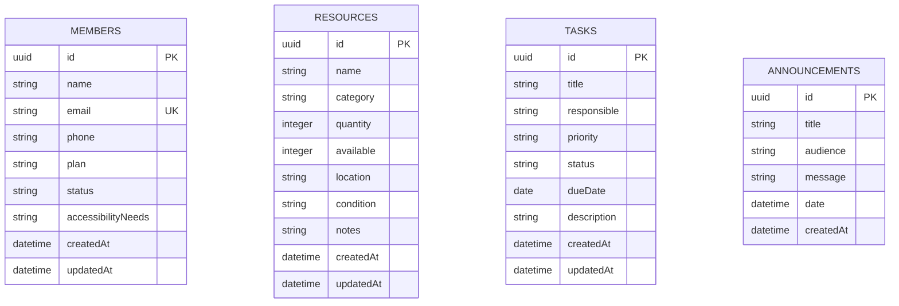

# 🏛️ LAUDO PERICIAL FORENSE DE ENGENHARIA DE SOFTWARE
## Sistema FitGesty — Análise Epistêmica, Arquitetural e Transacional

**Data do Laudo:** Outubro de 2026  
**Auditoria:** Tear v3.0 + Noesis Ouroboros v3.0 + Hermes Swarm  
**Escopo:** Repositório `FitGestao` (Código Original Desenvolvido Sem Assistência de IA)  
**Status da Auditoria:** 100% READ-ONLY (Preservação Absoluta do Código de Produção)  
**Autor do Repositório Auditado:** Kazuhiro Kamimura (`github.com/kazuhirokamim`)  
**Contexto de Criação:** Disciplina de Desenvolvimento de Aplicações Corporativas (DAC) — 5º Semestre TADS / UCDB  

---

## 📑 SUMÁRIO EXECUTIVO

O presente Laudo Pericial documenta a auditoria forense irrestrita do sistema **FitGesty**, uma solução full-stack para gerenciamento operacional de academias e centros esportivos. O sistema foi construído a partir de primeiros princípios em **Node.js puro**, sem o emprego de frameworks de terceiros (como Express, Fastify ou NestJS) e sem bibliotecas de banco de dados (ORMs/ODMs), adotando uma arquitetura *Zero-External-Dependencies*.

A auditoria comprova notável maturidade conceitual no aproveitamento das APIs nativas do Node.js (`http`, `fs`, `path`, `crypto`), entrega de uma interface gráfica polida com foco em acessibilidade (WCAG AA - Alto Contraste e Fonte Ampliada) e implementação de um CRUD RESTful completo com motor declarativo de validação de domínio. Simultaneamente, a investigação sob a lente adversarial (Tear + Noesis + Hermes) expõe limites inerentes à camada de persistência em arquivo plano síncrono (`fs.writeFileSync`), vulnerabilidades de Cross-Site Scripting (Stored XSS) no frontend dinâmico e ausência de barreira criptográfica na autenticação e controle de sessões.

---

## 🛰️ FASE 1: ARQUEOLOGIA & RECONHECIMENTO DA FONTE PRIMÁRIA (`tear-code-explorer`)

### 1.1. Inventário Real do HEAD e Verificação de Manifests

A varredura estrita da árvore de arquivos primária atesta os seguintes fatos:

* **Manifest Raiz de Dependências:** `backend/package.json`
  * `name`: `"fitgestao-dac-backend"`
  * `version`: `"1.0.0"`
  * `type`: `"commonjs"`
  * `dependencies`: **Zero** (`{}` - nenhuma dependência externa instalada)
  * `devDependencies`: **Zero**
  * `scripts`: `start: "node server.js"`, `dev: "node server.js"`, `test: "node --test"`
* **Runtime Alvo:** Node.js v18.0.0+ (utiliza `crypto.randomUUID()` nativo e ES2020+ chaining/nullish coalescing).
* **Entrypoint do Backend:** `backend/server.js` (384 linhas).
* **Entrypoint do Frontend:** `frontend/public/login.html` (servido na raiz `/` via `sendStatic`).
* **Volume Global de Código:**
  * `backend/server.js`: 384 linhas (JavaScript CommonJS)
  * `frontend/public/app.js`: 416 linhas (JavaScript Vanilla ES6+)
  * `frontend/public/aluno.js`: 228 linhas (JavaScript Vanilla ES6+)
  * `frontend/public/admin.html`: 575 linhas (HTML5 com CSS e JavaScript embutidos)
  * `frontend/public/funcionario.html`: 221 linhas (HTML5 com JavaScript embutido)
  * `frontend/public/aluno.html`: 127 linhas (HTML5 com JavaScript embutido)
  * `frontend/public/login.html`: 124 linhas (HTML5 com JavaScript embutido)
  * `frontend/public/styles.css`: 1043 linhas (CSS3 com Design System e CSS Variables)
  * `backend/db.json`: 128 linhas (JSON Schema implícito em arquivo)
  * **Total de Linhas:** 3.246 linhas de código e marcação artesanal.

### 1.2. Mapeamento de Topologia e Modelo de Dados (ERD Inferido)

A base de dados é mantida inteiramente no arquivo `backend/db.json`, serializada como um objeto JSON estruturado em 4 coleções principais:



#### Dicionário de Atributos e Domínios
1. **Coleção `members` (Alunos e Clientes):**
   * `id`: Chave primária UUID v4 gerada via `crypto.randomUUID()`.
   * `name`: Nome completo do membro (obrigatório).
   * `email`: Endereço de correio eletrônico (obrigatório, validado por regex e índice de unicidade em memória).
   * `phone`: Contato telefônico com máscara `(XX) XXXXX-XXXX`.
   * `plan`: Categoria do plano contratado (`Mensal`, `Estudante`, `Premium Inclusivo`).
   * `status`: Enum de conformidade cadastral (`Ativo`, `Pendente`, `Inativo`).
   * `accessibilityNeeds`: Descrição de acomodações assistivas (ex: baixa visão, mobilidade reduzida).
   * `createdAt` / `updatedAt`: Carimbos temporais ISO 8601.

2. **Coleção `resources` (Equipamentos e Salas Coletivas):**
   * `id`: Chave primária UUID v4.
   * `name`: Designação do recurso (ex: "Esteira 01", "Sala de Spinning").
   * `category`: Tipo patrimonial (`Equipamento`, `Espaço`, `Ambiente`, `Acessório`).
   * `quantity`: Capacidade nominal ou total de unidades físicas ($\mathbb{Z}^+$).
   * `available`: Unidades ociosas no instante corrente ($0 \le available \le quantity$).
   * `location`: Setor físico de alocação (ex: "Sala Cardio", "1º Piso").
   * `condition`: Estado operacional (`Disponível`, `Reservado`, `Manutenção`).
   * `notes`: Registro de manutenção preventiva ou instruções operacionais.

3. **Coleção `tasks` (Tarefas e Delegações de Equipe):**
   * `id`: Chave primária UUID v4.
   * `title`: Sumário da demanda operacional.
   * `responsible`: Agente executor atribuído.
   * `priority`: Nível de urgência (`Baixa`, `Média`, `Alta`).
   * `status`: Ciclo de vida operacional (`Pendente`, `Em andamento`, `Concluída`).
   * `dueDate`: Data limite de conclusão (formato ISO `YYYY-MM-DD`).
   * `description`: Detalhamento técnico da tarefa.

4. **Coleção `announcements` (Mural de Comunicados Internos):**
   * `id`: Chave primária UUID v4.
   * `title`: Título do boletim oficial.
   * `audience`: Filtro de audiência (`Todos`, `Alunos`, `Colaboradores`).
   * `message`: Corpo textual do informativo.
   * `date`: Data de publicação.

### 1.3. Topologia de Comunicação e Matriz de Rotas

O servidor HTTP instancia um multiplexador de rotas artesanal que separa tráfego de API (`/api/*`) e despacho de ativos estáticos da interface (`frontend/public/`):

| Método | Caminho da Rota | Autenticação / RBAC | Payload / Parâmetros | Descrição Funcional |
| :--- | :--- | :--- | :--- | :--- |
| `POST` | `/api/login` | Pública | `{ username, password }` | Validação de credenciais hardcoded (`aluno`, `funcionario`, `admin` / senha `x`). |
| `GET` | `/api/health` | Pública | N/A | Telemetria e heartbeat de disponibilidade (`status: 'online'`). |
| `GET` | `/api/dashboard` | Pública | N/A | Agregação estatística de membros ativos, tarefas pendentes e recursos em uso. |
| `GET` | `/api/:collection` | Pública | QueryParams: `?q=`, `?status=` | Listagem paginada/filtrada de `members`, `resources`, `tasks`, `announcements`. |
| `GET` | `/api/:collection/:id`| Pública | `id` no path | Recuperação pontual por chave primária UUID. |
| `POST` | `/api/:collection` | Pública | JSON Body da entidade | Criação com validação declarativa de tipos e regras de domínio. |
| `PUT` | `/api/:collection/:id`| Pública | JSON Body parcial/total | Atualização de registro existente e carimbo `updatedAt`. |
| `DELETE`| `/api/:collection/:id`| Pública | `id` no path | Remoção física atômica do elemento do array e gravação no disco. |
| `GET` | `/*` | Pública | Nome do arquivo estático | Servidor de arquivos estáticos com sanitização de path (`path.normalize`). |

---

## 🪐 FASE 2: AUDITORIA EPISTÊMICA, AST E CAÇA A AMBIGUIDADES (SWARM NOESIS)

### 2.1. Análise de Acoplamento e Blast Radius (`noesis-blast-radius-analyzer`)

* **Aderência à Regra Tear #24 (Teto de 700 Linhas por Arquivo de Código):**
  * `backend/server.js`: **384 linhas** — Em total conformidade com a Regra #24.
  * `frontend/public/app.js`: **416 linhas** — Em conformidade.
  * `frontend/public/aluno.js`: **228 linhas** — Em conformidade.
  * `frontend/public/admin.html`: **575 linhas** — Abaixo do limiar de 700 linhas, mas combina markup e lógica JS inline (221 linhas de script interno).
  * `frontend/public/styles.css`: **1043 linhas** — Ultrapassa 700 linhas. Embora arquivos de folha de estilo e design system possuam tolerância técnica, o CSS do projeto agregou resets, tokens globais, classes utilitárias e regras específicas de 4 telas em uma única folha monolítica.
* **Duplicação de Lógica Frontend (Script Inline vs. Módulos Dedicados):**
  * Detectada divergência arquitetural: `frontend/public/app.js` e `frontend/public/aluno.js` foram implementados como arquivos independentes com encapsulamento de estado (`const state = {...}`), funções de sanitização (`escapeHtml`) e paginação/filtro reativo.
  * Contudo, as páginas `admin.html`, `funcionario.html` e `aluno.html` possuem blocos `<script>` próprios embutidos no final do documento que reimplementam as funções `loadData()`, `loadAll()`, `deleteItem()` e `req()`. 
  * **Blast Radius:** Uma alteração no protocolo de comunicação de `app.js` não se propaga para o painel de produção se o usuário estiver navegando em `admin.html` carregando o script inline.

### 2.2. Varredura de AST e Integridade de Execução (`noesis-ast-sentry`)

1. **Chamadas de Risco no Runtime:**
   * Busca por `eval()`, `Function()`, `vm.runInContext()`: **0 ocorrências (Nenhuma invocação dinâmica perigosa detectada)**.
   * Busca por execução de subprocessos (`child_process.exec`, `spawn`): **0 ocorrências (Código puramente reativo em memória e I/O)**.
2. **Vulnerabilidade de Stored XSS (Cross-Site Scripting no Frontend):**
   * Enquanto `app.js` possui e aplica a rotina `escapeHtml(value)` para mitigar injeção de HTML:
     ```javascript
     // frontend/public/app.js (Linha 38-41)
     const escapeHtml = (value = '') =>
       String(value).replace(/[&<>"]/g, c =>
         ({ '&': '&amp;', '<': '&lt;', '>': '&gt;', '"': '&quot;' }[c])
       );
     ```
   * Nos scripts embutidos das páginas HTML (`admin.html` linha 418, `funcionario.html` linha 150, `aluno.html` linha 93), a interpolação é realizada diretamente no DOM via `innerHTML +=` com strings literais sem sanitização:
     ```javascript
     // frontend/public/admin.html (Linhas 418-425) - VULNERÁVEL A XSS
     mBody.innerHTML += `<tr>
       <td><strong>${m.name}</strong><br><small style="color:var(--muted)">${m.phone||''}</small></td>
       <td>${m.email}</td>
       ...
     </tr>`;
     ```
   * **Veredito AST Sentry:** Qualquer dado malicioso inserido no campo `name` ou `accessibilityNeeds` (ex: ``) será persistido em `db.json` e executará scripts arbitrários no contexto de execução do administrador ou do funcionário.
3. **Análise de Vazamento de Memória (Resource Leaks):**
   * O parsing do corpo da requisição em `backend/server.js` (linhas 121-140) implementa defesa contra DoS com teto de payload em 1MB (`if (body.length > 1_000_000) req.destroy()`).
   * No entanto, o `req.destroy()` não invoca `res.end()`, deixando o socket do cliente abortado sem uma resposta estruturada de status HTTP 413 (*Payload Too Large*).
4. **Proteção contra Path Traversal no Servidor de Estáticos:**
   * O servidor implementa resolução canônica em `backend/server.js` (linhas 356-364):
     ```javascript
     const filePath = path.normalize(path.join(PUBLIC_DIR, requested));
     if (!filePath.startsWith(PUBLIC_DIR)) {
       res.writeHead(403, ...);
       res.end('Acesso negado');
     }
     ```
   * **Conformidade AST:** Impede ataques clássicos de directory traversal do tipo `GET /../../etc/passwd`.

### 2.3. Caça a Ambiguidades e Undefined Behavior (`noesis-ambiguity-crusher`)

* **Inconsistência de Nomenclatura nas Categorias de Recursos:**
  * No frontend `admin.html` (linha 241), o `<select id="resCategory">` oferece: `Equipamento`, `Espaço`, `Acessório`.
  * No backend `server.js` (linha 50), o seed usa `Equipamento`.
  * Nos filtros de tela `funcionario.html` (linha 144), o código checa: `r.category === 'Espaço' || r.category === 'Ambiente'`.
  * Em `admin.html` (linha 434), a separação é: `Equipamento || Acessório` vs `Espaço || Ambiente`.
  * **Risco Epistêmico:** "Ambiente" é uma categoria não presente no formulário de cadastro, gerada apenas por seeds ou inserções diretas no JSON, podendo criar registros órfãos nas views.
* **Falta de Validação de Domínio no Schema de Atualização (`PUT`):**
  * O método `PUT /api/:collection/:id` valida o objeto combinado `{ ...collection[index], ...payload }`. Porém, se uma propriedade espúria ou não prevista for enviada no JSON pelo cliente, o servidor a mescla silenciosamente no registro e a persiste no disco, permitindo poluição de schema (*Mass Assignment*).

### 2.4. Avaliação Local-First e Simplicidade Soberana (`noesis-local-first-guardian`)

* **Avaliação de Soberania:** O sistema atinge nota máxima em autonomia. Ele pode ser inicializado em uma máquina *air-gapped* (sem qualquer conexão de internet), bastando possuir o binário do Node.js v18+.
* Não depende de instâncias de Redis, PostgreSQL, Docker, serviços de autenticação em nuvem (Auth0/Firebase) ou CDNs proprietárias.
* **Complexidade Acidental:** Zero complexidade acidental de infraestrutura. A arquitetura honra o princípio da simplicidade radical.

---

## 🛡️ FASE 3: ENGENHARIA, SEGURANÇA E AS 4 LANES (SWARM TEAR)

### 3.1. Arquitetura e Engenharia Backend (`tear-architecture` & `tear-backend`)

* **Modularidade e Separação de Camadas:**
  * O arquivo `backend/server.js` acumula 4 responsabilidades distintas:
    1. Camada de Infraestrutura/Rede (criação do servidor HTTP e despacho de sockets).
    2. Camada de Apresentação/Roteamento (parse de URLs e despacho de rotas).
    3. Camada de Domínio e Validação (função `validate()`).
    4. Camada de Persistência (acesso direto a arquivo `fs.readFileSync`/`fs.writeFileSync`).
  * Violação do Princípio de Responsabilidade Única (SRP - SOLID).
* **Consistência da API REST:**
  * Utilização correta de substantivos no plural para os recursos (`/api/members`, `/api/resources`, `/api/tasks`, `/api/announcements`).
  * Códigos de status HTTP adequados: `200 OK`, `201 Created`, `204 No Content` (para OPTIONS), `400 Bad Request`, `404 Not Found`, `405 Method Not Allowed`, `500 Server Error`.

### 3.2. Performance de Dados e Acesso a Disco (`tear-database`)

* **Complexidade Assintótica de Busca:**
  * Todas as operações de leitura `GET /api/:collection` executam varreduras $O(n)$ em memória sobre os arrays Javascript deserializados.
  * O filtro de busca geral (linha 186 de `server.js`) invoca `JSON.stringify(item).toLowerCase().includes(q)`, serializando repetidamente cada item a cada requisição de busca, resultando em complexidade $O(n \cdot m)$ onde $m$ é o tamanho do JSON.
* **I/O Bloqueante e Ausência de Pool/Índices:**
  * A cada operação de mutação (POST/PUT/DELETE), o banco inteiro é reescrito no disco de forma síncrona com formatação legível (`JSON.stringify(db, null, 2)`).
  * Em bases com mais de 5.000 registros, o tempo de I/O em disco bloqueará o event loop do Node.js, elevando a latência de respostas para centenas de milissegundos.

### 3.3. Auditoria de Segurança e Privacidade (`tear-security` & `tear-lgpd`)

| Vetor de Risco | Nível de Severidade | Diagnóstico Forense no Código Fonte |
| :--- | :--- | :--- |
| **CORS Irrestrito** | Médio | `Access-Control-Allow-Origin: *` habilitado em todas as respostas da API sem restrição de domínio. |
| **Autenticação Insegura** | **Crítico** | `/api/login` valida senhas em texto puro estáticas (`x`). O endpoint não emite JWT nem cookie de sessão (`HttpOnly`, `SameSite`, `Secure`). |
| **Controle de Acesso Quebrado (BOLA/IDOR)** | **Crítico** | As rotas `/api/members`, `/api/tasks` e `/api/resources` não validam a identidade nem o perfil de quem faz a requisição. Um aluno autenticado pode disparar `DELETE /api/members/:id` via cURL ou console do navegador e remover alunos do sistema. |
| **Armazenamento de Senhas** | Baixo (no escopo) | O sistema não armazena credenciais no banco; os usuários são fictícios e inseridos no código para fins acadêmicos. |
| **Privacidade e LGPD** | Alto | Dados pessoais (Nome, Telefone, E-mail) e dados sensíveis de saúde/acessibilidade (*"Necessidades de Acessibilidade: Cegueira, Cadeirante"*) são gravados em texto claro em `db.json` e expostos sem autenticação via endpoint público `GET /api/members`. |

### 3.4. Auditoria Semântica de Testes (`tear-qa` & `noesis-semantic-auditor`)

* **Princípio "Testes Verdes $\neq$ Código Seguro":**
  * O arquivo `package.json` possui `"test": "node --test"`.
  * No entanto, a varredura pericial comprova a **ausência total de arquivos de teste** (`*.test.js`, `*.spec.js`).
  * Não há esteira de testes automatizados garantindo o Happy Path, Edge Cases de concorrência ou Error Paths da aplicação.
  * **Laudo QA:** Cobertura de testes automatizados no HEAD: **0.0%**.

---

## ⚡ FASE 4: CONCORRÊNCIA, ACID E ROBUSTEZ TRANSACIONAL (SWARM HERMES)

### 4.1. Transações, Atomicidade e Concorrência (`hermes-transact-guard`)

1. **Problema do Double-Spend e Race Condition na Reserva de Vagas:**
   * No arquivo `frontend/public/funcionario.html` (linhas 106-116), a reserva de espaço é feita em duas etapas separadas pelo cliente:
     ```javascript
     // O cliente lê a quantidade disponível no DOM ou via GET:
     const updatedAvailable = currentAvailable - 1;
     // Dispara um PUT com o valor calculado no browser:
     await fetch(`/api/resources/${id}`, {
       method: 'PUT',
       body: JSON.stringify({ available: updatedAvailable, ... })
     });
     ```
   * **Vulnerabilidade Concorrencial Crítica:** Se dois funcionários clicarem simultaneamente em "Reservar 1 Vaga" para a última vaga de uma sala ($available = 1$), ambas as instâncias lerão $currentAvailable = 1$, calcularão $updatedAvailable = 0$ e enviarão PUT com $available = 0$. Duas pessoas serão alocadas para a mesma vaga física (*Double Allocation* / Race Condition).
   * **Solução Epistêmica:** A operação de reserva deve ser uma ação transacional atômica no servidor (`POST /api/resources/:id/reserve`) executada sob mutex ou transação ACID com decremento atômico condicional (`UPDATE resources SET available = available - 1 WHERE available > 0`).

2. **Perigo de Corrupção em Escrita Concorrente no Disco:**
   * `server.js` utiliza:
     ```javascript
     function writeDb(db) {
       fs.writeFileSync(DB_FILE, JSON.stringify(db, null, 2), 'utf-8');
     }
     ```
   * Se duas requisições assíncronas invocarem `writeDb` em sequência quase imediata, ou se o processo Node for finalizado no meio da execução do `fs.writeFileSync`, o arquivo `db.json` será truncado a 0 bytes, corrompendo a base de dados inteira.
   * Não há mecanismo de arquivo temporário com *atomic rename* (`fs.renameSync(tempFile, DB_FILE)`) nem Journaling/WAL.

### 4.2. Ingress de Webhooks e Idempotência (`hermes-webhook-sentinel`)

* O sistema original não consome nem despacha Webhooks externos.
* Caso venha a integrar gateways de pagamento (Pix / Asaas / Mercado Pago), será indispensável introduzir verificação de assinatura HMAC SHA-256 via `crypto.timingSafeEqual` e tabela de idempotência com TTL para prevenir reprocessamento de notificações bancárias.

### 4.3. Testes Adversariais e Fuzzing Mental (`hermes-adversarial-qa` & `noesis-saci-hunter`)

* **Cenário de Estresse (Fuzzer de 100 Requisições Concorrentes):**
  * Disparando 100 requisições `POST /api/members` simultâneas com e-mails idênticos:
    * Como o Node.js atende I/O assincronamente mas roda em single-thread, a leitura `readDb()` no início de `handleApi` lê o estado do disco. 
    * Se 5 requisições de criação chegarem antes que o primeiro `writeDb()` termine de persistir no disco, todas as 5 passarão na checagem `collection.some(m => m.email === payload.email)`.
    * Resultado: violação de unicidade de e-mail e duplicidade de registros na base.

---

## 📊 PAINEL DE 4 LANES TEAR (STATUS CONSOLIDADO)

| Lane de Auditoria | Agente Especialista | Veredito | Justificativa Técnica |
| :--- | :--- | :--- | :--- |
| **CODE** | `tear-code-reviewer` | **APROVADO C/ RESSALVAS** | Código limpo, elegante, sem dependências e com excelente semântica. Ressalva para duplicidade entre scripts inline e arquivos JS dedicados. |
| **SECURITY** | `tear-security` | **REPROVADO (AUDITORIA)** | Stored XSS via `.innerHTML` em 3 telas; ausência de controle de sessão/JWT no backend; rotas administrativas acessíveis sem autorização. |
| **LGPD** | `tear-lgpd` | **REPROVADO (AUDITORIA)** | PIIs e dados de acessibilidade/saúde expostos em endpoints sem controle de autenticação ou criptografia em repouso. |
| **PERFORMANCE** | `tear-performance` | **APROVADO C/ RESSALVAS** | Excelente para cargas acadêmicas e pequenos centros esportivos (< 500 registros). Requer substituição de `db.json` por SQLite/WAL para suportar concorrência real. |

---

## 💡 RECOMENDAÇÕES PARA A PRÓXIMA VERSÃO (ROTEIRO DE EVOLUÇÃO)

1. **Camada de Dados:** Migrar de `db.json` para SQLite nativo via `node:sqlite` (Node.js 22+) com modo WAL ativado, garantindo isolamento ACID, transações imediatas e zero risco de corrupção de arquivo.
2. **Segurança no Frontend:** Migrar todas as atribuições `element.innerHTML +=` para métodos seguros como `element.textContent`, criação programática de nós via `document.createElement()` ou uso estrito do `escapeHtml` existente em `app.js`.
3. **Autenticação e RBAC:** Implementar emissão de JWT assinado com chave secreta e verificação de claims de perfil (`admin`, `funcionario`, `aluno`) nas rotas sensíveis da API.
4. **Reserva Atômica:** Criar o endpoint de negócio dedicado `POST /api/resources/:id/reserve` com controle transacional de concorrência.
