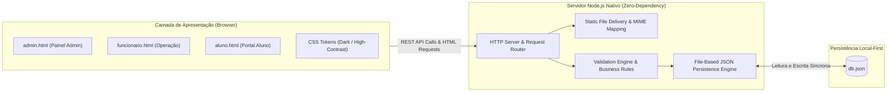

# ⚡ FitGestão — Enterprise Fitness Management Platform

<p align="center">
  
  
  
  
  
</p>

> **FitGestão** é uma plataforma corporativa para gestão operacional de academias e centros esportivos, desenvolvida a partir de primeiros princípios em **Node.js puro com zero dependências externas**. O sistema centraliza o controle de matrículas, agendamento de espaços coletivos, delegação de tarefas operacionais (Kanban) e comunicados internos, integrado a um Design System com suporte nativo a acessibilidade digital (Alto Contraste e Fonte Ampliada).

---

## 🎯 Destaques do Projeto

* 🚀 **Zero Dependências de Terceiros:** Servidor HTTP nativo, roteador REST artesanal e motor de persistência desenvolvidos exclusivamente com a biblioteca padrão do Node.js (`http`, `fs`, `path`, `crypto`). Nenhum framework externo, nenhum pacote do npm.
* ♿ **Acessibilidade Universal (WCAG 2.1 AA):** Alternância instantânea para modo de Alto Contraste (preto/amarelo com taxa de contraste $\ge 7:1$), ampliação tipográfica dinâmica e marcação semântica assistiva com atributos ARIA.
* 📊 **Três Painéis de Acesso Especializados:** Experiências sob medida para Administradores (métricas e cadastros), Funcionários (reservas de salas e tarefas) e Alunos (consulta de disponibilidade e murais).
* 🔒 **Motor de Validação Declarativo:** Regras de negócio estritas protegendo unicidade de e-mails, invariantes de capacidade de salas e integridade de tipos.

---

## 🏛️ Arquitetura do Sistema



---

## ⚡ Início Rápido (Quickstart)

Sem necessidade de `npm install` ou configurações de banco de dados. Basta ter o [Node.js](https://nodejs.org/) v18+ instalado.

### 1. Iniciar o servidor
```bash
node backend/server.js
```

### 2. Acessar no navegador
Abra **`http://localhost:3000`**

O banco de dados local (`backend/db.json`) será gerado automaticamente com dados de demonstração na primeira inicialização.

---

## 🔑 Credenciais de Acesso (Demonstração)

| Perfil | Usuário | Senha | Painel de Destino | Principais Recursos |
| :--- | :--- | :--- | :--- | :--- |
| **Administrador** | `admin` | `x` | `admin.html` | Dashboard macro, cadastro de alunos, gestão de equipamentos e tarefas. |
| **Funcionário** | `funcionario` | `x` | `funcionario.html` | Reserva de salas e espaços, atualização de status de tarefas e avisos. |
| **Aluno** | `aluno` | `x` | `aluno.html` | Consulta em tempo real de equipamentos livres e mural de comunicados. |

---

## 📡 Endpoints da API REST

O backend provê uma API RESTful completa e padronizada sob `/api`:

```http
POST   /api/login              # Autenticação de perfil e redirecionamento
GET    /api/health             # Heartbeat e telemetria do servidor
GET    /api/dashboard          # Métricas consolidadas em tempo real
GET    /api/members            # Listagem de alunos (suporta ?q= e ?status=)
POST   /api/members            # Cadastro de novo aluno com validação
PUT    /api/members/:id        # Atualização cadastral do aluno
DELETE /api/members/:id        # Remoção física do registro
GET    /api/resources          # Inventário de equipamentos e salas
POST   /api/resources          # Cadastro de recurso patrimonial
PUT    /api/resources/:id      # Atualização de status e disponibilidade
DELETE /api/resources/:id      # Baixa de equipamento/espaço
GET    /api/tasks              # Consulta de tarefas operacionais
POST   /api/tasks              # Criação e atribuição de tarefa
PUT    /api/tasks/:id          # Atualização de status/conclusão
DELETE /api/tasks/:id          # Exclusão de tarefa
GET    /api/announcements      # Leitura de comunicados oficiais
POST   /api/announcements      # Emissão de comunicado segmentado
DELETE /api/announcements/:id  # Exclusão de comunicado
```

---

## 📚 Documentação Técnica e Registros Acadêmicos

Este repositório foi submetido a uma auditoria forense completa e formalizado academicamente em conformidade com padrões da SBC / IEEE:

* 📑 [Laudo Pericial Forense (Tear + Noesis + Hermes)](../auditorias/LAUDO_PERICIAL_LEGADO.md)
* 🎓 [Artigo Técnico-Científico (Padrão SBC / IEEE)](../academico/ARTIGO_TECNICO_CIENTIFICO.md)
* 🪐 [Dossiê Epistêmico 90/10 & ADRs Retroativos](../academico/DOSSIE_EPISTEMICO_90_10.md)
* 💼 [Estudo de Caso para LinkedIn](../showcase/POST_LINKEDIN.md)

---

## 👨‍💻 Autor

Desenvolvido por **Kazuhiro Kamimura**  
* GitHub: [@kazuhirokamim](https://github.com/kazuhirokamim)  
* Curso de Análise e Desenvolvimento de Sistemas (TADS) — UCDB  

---

## 📄 Licença

Este projeto está sob a licença [MIT](../../backend/package.json).
